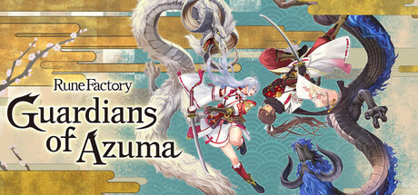

**Rune Factory: Guardians of Azuma is the newest Rune Factory following Guardians protecting the land in a Japan-inspired setting. Features new farming mechanics, battle companion systems, and the series' signature blend of action RPG and life simulation.**

---

## 📖 About

Rune Factory: Guardians of Azuma is the newest Rune Factory following Guardians protecting the land in a Japan-inspired setting. Features new farming mechanics, battle companion systems, and the series' signature blend of action RPG and life simulation.

## ⚠️ Problems Without Trainer

| Problem | Status |
|---------|--------|
| **New System Learning** — Japan-inspired seasonal and spirit systems require learning new mechanics | ✅ Solved |
| **Monster Partner Bonds** — Raising battle companions requires consistent daily interaction and care | ✅ Solved |
| **Dungeon Difficulty** — Area boss encounters scale sharply in later regions | ✅ Solved |
| **Crafting Material Rarity** — High-tier equipment materials require difficult dungeon encounters to obtain | ✅ Solved |

## ✅ Solution

The **Rune Factory: Guardians of Azuma Trainer** solves all these issues by giving you complete control over the game.

## 🎯 Full Feature List

- Unlimited Resources
- God Mode / Invincibility
- Instant Skill Cooldown
- One-Hit Kill
- Freeze Game Timer
- Unlock All Items & Achievements
- Custom Speed Multiplier
- Save State Anywhere

## 🚀 Quick Start

1. **Disable Windows Defender** temporarily (trainer may trigger false positive)
2. Download the trainer from the button above
3. Launch Rune Factory: Guardians of Azuma
4. Run the trainer as Administrator
5. Activate desired cheats with hotkeys

## 💎 Free vs Paid

| Feature | Free | Pro |
|---------|------|-----|
| Basic God Mode | ✅ | ✅ |
| Unlimited Resources | ✅ | ✅ |
| All Advanced Cheats | ❌ | ✅ |
| Auto-Updates | ❌ | ✅ |
| Priority Support | ❌ | ✅ |

## 💻 Requirements

- Windows 10/11 (64-bit)
- Rune Factory: Guardians of Azuma (any version)
- .NET Framework 4.8+
- DirectX 11+

## 🍎 macOS

macOS users can use our alternative tool:

## ⚖️ Legal

This trainer is for educational and single-player use only. Use responsibly.

---

